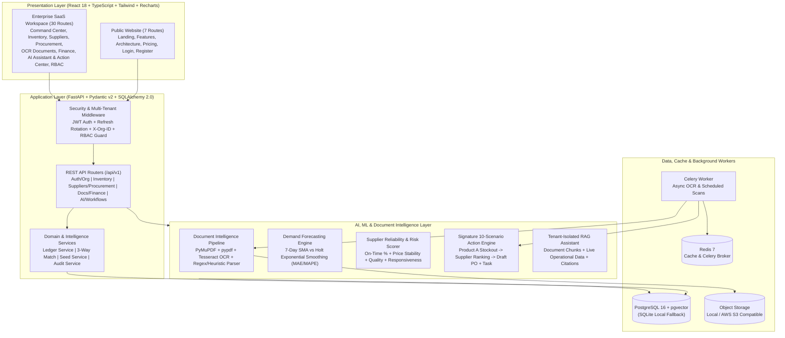

# SUTRADHAR — AI-Powered Business Operations, Intelligence & Decision Automation Platform

> **"One intelligent workspace to manage, understand and improve your entire business operation."**

- **Live Production Website (24/7 Railway Cloud HTTPS)**: **https://sutradhar-production-9161c51a.up.railway.app**
- **Live Interactive API Docs (Swagger UI)**: **https://sutradhar-production-9161c51a.up.railway.app/api/docs**
- **Live Health Endpoint**: **https://sutradhar-production-9161c51a.up.railway.app/api/v1/health**

**Sutradhar** is an enterprise-grade, multi-tenant Business Operations and Decision Intelligence SaaS platform purpose-built for **Indian MSMEs, discrete manufacturers, and wholesale distributors**. It unifies multi-warehouse inventory, supplier reliability intelligence, procurement workflows, OCR/PDF document intelligence, GST-ready financial tracking, workflow automation, and a **human-in-the-loop AI Business Intelligence & Action Engine**.

> [!NOTE]
> **Disclaimer**: Sutradhar is an operational intelligence, procurement, inventory, and financial visibility platform supporting Indian currency (`INR` / `₹`), Indian numbering (`1,25,000`), HSN codes, and configurable GST rates (`0%`, `5%`, `12%`, `18%`, `28%`). It is designed to complement—not replace—certified statutory tax filing or statutory accounting audit software.

---

## Table of Contents

1. [Problem Statement & Vision](#1-problem-statement--vision)
2. [Key Platform Capabilities (8 Core Modules)](#2-key-platform-capabilities-8-core-modules)
3. [Signature Feature: AI Business Intelligence & Action Engine](#3-signature-feature-ai-business-intelligence--action-engine)
4. [System Architecture](#4-system-architecture)
5. [Database Design & Entity-Relationship Diagram](#5-database-design--entity-relationship-diagram)
6. [Technology Stack](#6-technology-stack)
7. [Application Pages & UI Overview (37 Routes)](#7-application-pages--ui-overview-37-routes)
8. [Installation & Local Setup](#8-installation--local-setup)
9. [Environment Configuration](#9-environment-configuration)
10. [Running with Docker Compose](#10-running-with-docker-compose)
11. [Testing & Verification](#11-testing--verification)
12. [API Documentation Summary](#12-api-documentation-summary)
13. [Cloud Deployment, Costs & Required GitHub Secrets](#13-cloud-deployment-costs--required-github-secrets)
14. [Future Scope & Contribution Guide](#14-future-scope--contribution-guide)

---

## 1. Problem Statement & Vision

Indian MSMEs and wholesale distributors typically manage critical operations across disconnected spreadsheets, PDFs, WhatsApp messages, and legacy desktop software. This fragmentation causes 12 recurring operational failures:

1. **Scattered operational data** across Excel files, PDFs, WhatsApp, and siloed tools.
2. **Manual, error-prone data entry** for supplier invoices and purchase orders.
3. **Late discovery of inventory stockouts** on critical production or fast-moving SKUs.
4. **Difficulty comparing supplier quotations** across unit prices, GST, and delivery lead times.
5. **Slow, opaque purchase approvals** with no audit trail.
6. **Unmonitored supplier delivery delays** impacting production schedules.
7. **Missed financial obligations and invoice due dates** leading to supplier friction or cash shortages.
8. **Lack of real-time executive visibility** into working capital and operational bottlenecks.
9. **Unsearchable document archives** where contracts, POs, and tax invoices are buried in folders.
10. **Gut-feel purchasing and reorder decisions** instead of data-driven demand forecasting.
11. **Repetitive manual follow-ups** consuming employee bandwidth.
12. **Alert fatigue or blindness** where owners cannot immediately see what requires urgent attention today.

**Sutradhar** solves these challenges by connecting every operational event—stock movements, purchase requests, RFQs, supplier quotations, purchase orders, goods received notes (GRNs), OCR-extracted invoices, and accounts payable/receivable—into a single multi-tenant data fabric continuously monitored by an **AI Decision & Action Engine**.

---

## 2. Key Platform Capabilities (8 Core Modules)

| Module | Capabilities |
| :--- | :--- |
| **A. Multi-Tenant Organisation & RBAC** | Multi-company workspaces, secure tenant switching (`X-Org-ID` + JWT validation), member invitations, custom permission matrix across **6 roles** (`OWNER`, `OPERATIONS_MANAGER`, `FINANCE_MANAGER`, `PROCUREMENT_OFFICER`, `WAREHOUSE_EMPLOYEE`, `AUDITOR`), and immutable audit logging. |
| **B. AI Document Intelligence** | PDF & scanned receipt upload, PyMuPDF + Tesseract OCR extraction, automatic document classification (`INVOICE`, `PURCHASE_ORDER`, `RECEIPT`, `QUOTATION`, `CONTRACT`), GSTIN & line-item extraction, confidence scoring, SHA-256 + fingerprint duplicate detection, human verification workflow, and **3-way PO-GRN-Invoice matching**. |
| **C. Inventory Intelligence** | Multi-warehouse stock ledger, HSN/GST/barcode catalogue, batch & expiry tracking, stock adjustment approvals, dynamic reorder point ($\text{ROP}$) calculation, **30-day demand forecasting** (7-day SMA vs Holt Exponential Smoothing with backtested MAE/MAPE), dead-stock detection, and FIFO/weighted-average valuation. |
| **D. Supplier Intelligence** | Supplier onboarding with GSTIN/PAN verification, quotation history, automated **Supplier Reliability Score** ($0.40 \times \text{On-Time} + 0.25 \times \text{Price Stability} + 0.20 \times \text{Quality} + 0.15 \times \text{Responsiveness}$), price fluctuation tracking, and explainable risk alerts. |
| **E. Procurement Management** | Purchase Requests (PR), multi-level approval workflows, RFQ generation, side-by-side supplier quotation matrix, Purchase Order (PO) lifecycle tracking, and Goods Received Notes (GRN) that automatically update warehouse stock and supplier delivery metrics. |
| **F. Financial Intelligence** | Accounts Payable & Receivable ledgers, overdue aging analysis, partial/full payment recording, expense categorisation, P&L summary, and 30-day cash-flow forecasting vs upcoming payables. |
| **G. AI Business Intelligence** | Natural-language **RAG Business Assistant** with document & database citations, executive morning briefing, anomaly detection, and the **10-Scenario Signature Action Engine**. |
| **H. Workflow Automation & Tasks** | Event-driven automation rule builder (`LOW_STOCK_DETECTED`, `INVOICE_UPLOADED`, `PO_APPROVAL_PENDING`, `SUPPLIER_DELIVERY_LATE`, `PAYMENT_OVERDUE`), execution logs, and integrated team task management. |

---

## 3. Signature Feature: AI Business Intelligence & Action Engine

Unlike passive dashboards or generic chatbots, Sutradhar includes a deterministic + AI-assisted **Business Intelligence & Action Engine** ([`backend/app/ai/action_engine.py`](backend/app/ai/action_engine.py)) that continuously evaluates **10 high-impact operational scenarios**:

1. **Inventory Stockout Prediction (`STOCKOUT_PREDICTION`)**
2. **Supplier Delivery Delay Impact (`SUPPLIER_DELAY_IMPACT`)**
3. **Supplier Price Spike Anomaly (`SUPPLIER_PRICE_INCREASE`)**
4. **Pending Purchase Approval Bottleneck (`PENDING_APPROVAL_BOTTLENECK`)**
5. **Overdue Accounts Payable Obligation (`OVERDUE_PAYABLE_OBLIGATION`)**
6. **30-Day Cash-Flow Pressure (`CASH_FLOW_PRESSURE`)**
7. **Dead Stock Capital Lockup (`DEAD_STOCK_CAPITAL_LOCKUP`)**
8. **Duplicate Invoice Prevention (`DUPLICATE_INVOICE_RISK`)**
9. **Frequent Manual Stock Adjustment Anomaly (`FREQUENT_STOCK_ADJUSTMENTS`)**
10. **High Supplier Concentration Risk (`SUPPLIER_CONCENTRATION_RISK`)**

### End-to-End "Product A" Demonstration Scenario
Out of the box, the seeded workspace (**Bharat Precision Components Pvt Ltd**) includes the complete **Product A (`SKU-PRODA-001` — Product A - Industrial Bearing SKF-6205)** scenario:
- **Current Stock**: `42 PCS` across Bhiwandi Central Hub & Chakan Assembly Store.
- **Consumption Velocity**: `10.0 PCS/day` (remaining stockout window: **`4.2 days`**).
- **Supplier Comparison**:
  - *Shree Balaji Bearings & Fasteners*: Unit price `₹430`, Reliability Score `93.6%`, Lead time `4 days` (**Recommended**).
  - *Western India Industrial Supplies*: Unit price `₹415`, Reliability Score `66.1%`, Lead time `9 days` (Too slow—exceeds 4.2-day stockout window).
- **Human-Approved Automated Action**: Clicking **"Approve & Execute Action"** in the UI (or calling `POST /api/v1/ai/recommendations/{id}/decide`) atomically generates a **Draft Purchase Order** for `200 PCS` (`₹1,01,480` incl. 18% GST) with Shree Balaji Bearings, creates a high-priority **Procurement Approval Task**, and writes an **Audit Log** entry.

---

## 4. System Architecture

Detailed architecture documentation is available in [`docs/architecture.md`](docs/architecture.md).



---

## 5. Database Design & Entity-Relationship Diagram

Sutradhar implements **34 normalized relational tables** managed via SQLAlchemy 2.0 and Alembic migrations ([`backend/migrations/versions/0001_initial_sutradhar_schema.py`](backend/migrations/versions/0001_initial_sutradhar_schema.py)). Full table specifications are documented in [`docs/database-design.md`](docs/database-design.md).

```mermaid
erDiagram
    ORGANISATIONS ||--o{ ORGANISATION_MEMBERSHIPS : "has members"
    USERS ||--o{ ORGANISATION_MEMBERSHIPS : "belongs to"
    ROLES ||--o{ ORGANISATION_MEMBERSHIPS : "assigns role"
    ORGANISATIONS ||--o{ WAREHOUSES : "operates"
    ORGANISATIONS ||--o{ PRODUCTS : "catalogues"
    ORGANISATIONS ||--o{ SUPPLIERS : "onboards"
    PRODUCTS ||--o{ INVENTORY_BALANCES : "stocked in"
    WAREHOUSES ||--o{ INVENTORY_BALANCES : "holds"
    PRODUCTS ||--o{ STOCK_LEDGER_ENTRIES : "movements"
    PRODUCTS ||--o{ DEMAND_FORECASTS : "forecasted"
    SUPPLIERS ||--o{ SUPPLIER_SCORECARDS : "scored by"
    ORGANISATIONS ||--o{ PURCHASE_REQUESTS : "raises"
    ORGANISATIONS ||--o{ RFQS : "issues"
    RFQS ||--o{ SUPPLIER_QUOTATIONS : "receives"
    SUPPLIERS ||--o{ PURCHASE_ORDERS : "fulfills"
    PURCHASE_ORDERS ||--o{ PURCHASE_ORDER_ITEMS : "contains"
    PURCHASE_ORDERS ||--o{ GOODS_RECEIVED_NOTES : "received via"
    ORGANISATIONS ||--o{ DOCUMENTS : "uploads"
    DOCUMENTS ||--o{ DOCUMENT_EXTRACTIONS : "OCR extracted"
    DOCUMENTS ||--o{ DOCUMENT_CHUNKS : "RAG indexed"
    ORGANISATIONS ||--o{ INVOICES : "records AP/AR"
    INVOICES ||--o{ PAYMENTS : "settled by"
    ORGANISATIONS ||--o{ AI_RECOMMENDATIONS : "generates"
    ORGANISATIONS ||--o{ AUTOMATION_RULES : "automates"
    ORGANISATIONS ||--o{ TASKS : "tracks"
    ORGANISATIONS ||--o{ AUDIT_LOGS : "audits"
```



---

## 6. Technology Stack

- **Frontend**: React 18, TypeScript 5, Vite 6, Tailwind CSS 3.4, React Router v6, TanStack Query v5, React Hook Form, Zod, Recharts, Lucide Icons, Vitest + React Testing Library.
- **Backend**: Python 3.11+, FastAPI, Pydantic v2, SQLAlchemy 2.0, Alembic, PyJWT + bcrypt, Celery + Redis.
- **Database**: PostgreSQL 16 + `pgvector` (with zero-configuration SQLite fallback for immediate local execution).
- **AI / ML / OCR**: Provider abstraction supporting Google Gemini, OpenAI, and a built-in **Deterministic Local Intelligence Engine** (works 100% offline without paid API keys), PyMuPDF (`pymupdf`), `pypdf`, `pytesseract`, `scikit-learn`, `numpy`, `pandas`.
- **DevOps**: Docker, Docker Compose, Nginx, GitHub Actions CI/CD.

---

## 7. Application Pages & UI Overview (37 Routes)

### Public Website (7 Pages)
1. `/` — **Landing Page** (Hero, live Product A stockout preview, problem/solution matrix, Indian MSME metrics)
2. `/features` — **Product Features** (Deep dive into all 8 interconnected modules)
3. `/architecture` — **How It Works / Architecture** (Multi-tenant security, 3-way match, AI pipeline)
4. `/pricing` — **Pricing & Plans** (Transparent INR tiers for Indian MSMEs)
5. `/login` — **Sign In** (With 1-click Demo Role Switcher for all 6 Indian MSME roles)
6. `/register` — **Organisation Registration** (Creates a new tenant workspace, owner account, and default warehouse)
7. `/forgot-password` — **Password Recovery**

### Authenticated Enterprise Workspace (30 Pages)
8. `/app/dashboard` — **Executive Command Center** (Real-time KPIs, cash-flow vs demand charts, urgent AI actions)
9. `/app/action-center` — **Business Health & Action Center** (10-scenario risk engine & human approval workflow)
10. `/app/documents` — **Document Upload & Intelligence Hub**
11. `/app/documents/:id/verify` — **OCR Document Extraction & Human Verification Studio**
12. `/app/products` — **Product Catalogue** (SKU, HSN, GST %, UOM, reorder formulas)
13. `/app/products/:id` — **Product Detail & Batch/Ledger History**
14. `/app/warehouses` — **Multi-Warehouse Management**
15. `/app/inventory/movements` — **Inventory Stock Movements & Transfers**
16. `/app/inventory/low-stock` — **Low-Stock & Reorder Center**
17. `/app/inventory/forecasting` — **Demand Forecasting Analytics** (SMA vs Holt Exponential Smoothing + MAE/MAPE)
18. `/app/suppliers` — **Supplier Directory**
19. `/app/suppliers/:id` — **Supplier Detail & Reliability Scorecard**
20. `/app/suppliers/comparison` — **Supplier Quotation Comparison Matrix**
21. `/app/procurement/requests` — **Purchase Requests (PR)**
22. `/app/procurement/approvals` — **Multi-Level Approval Center**
23. `/app/procurement/rfqs` — **RFQ Management**
24. `/app/procurement/orders` — **Purchase Orders (PO)**
25. `/app/procurement/orders/:id` — **Purchase Order Detail & 3-Way Match Status**
26. `/app/procurement/grns` — **Goods Received Notes (GRN)**
27. `/app/finance/invoices` — **Invoice Management (GST Tax Invoices)**
28. `/app/finance/payables` — **Accounts Payable & Aging**
29. `/app/finance/receivables` — **Accounts Receivable & Collections**
30. `/app/finance/cash-flow` — **Cash-Flow & Financial Analytics**
31. `/app/finance/expenses` — **Expense Management**
32. `/app/ai-assistant` — **AI Business Assistant (RAG + Structured Operational QA)**
33. `/app/workflows` — **Workflow Automation Builder**
34. `/app/tasks` — **Tasks & Alerts Center**
35. `/app/settings/team` — **Team & Role Management (6 Roles + Invitations)**
36. `/app/settings/organisation` — **Organisation Settings (GSTIN, PAN, Currency, FY)**
37. `/app/settings/audit-logs` — **Immutable Security & Operational Audit Logs**

---

## 8. Installation & Local Setup

### Prerequisites
- **Python 3.11+** (tested with Python 3.11, 3.12, and 3.14)
- **Node.js 20+** and **npm**

### Step 1: Backend Setup (Using Project Virtual Environment)
From the repository root (`sutradhar/`):

```powershell
# 1. Create and use the project virtual environment (.venv)
python -m venv .venv

# 2. Install backend dependencies inside .venv
.\.venv\Scripts\pip.exe install -r backend/requirements.txt

# 3. Run Alembic database migrations (creates sutradhar.db or migrates PostgreSQL)
Push-Location backend
..\.venv\Scripts\alembic.exe upgrade head

# 4. Start the FastAPI backend server on http://localhost:8000
# (Automatically seeds the realistic Indian MSME dataset on startup)
..\.venv\Scripts\uvicorn.exe app.main:app --reload --host 0.0.0.0 --port 8000
Pop-Location
```

### Step 2: Frontend Setup
Open a second terminal in the repository root:

```powershell
Push-Location frontend
npm.cmd install
npm.cmd run dev
Pop-Location
```

Visit **`http://localhost:5173`** in your browser.

### Demo Login Credentials (Pre-Seeded Indian MSME Workspace)
Organisation: **Bharat Precision Engineering Pvt. Ltd. (Demo)** (`27AABCB1234F1Z5`) & **Deccan Agro & Trading Co.** (`27AABCD8899K1Z2`)

| Role | Email | Password |
| :--- | :--- | :--- |
| **Organisation Owner / Super Admin** | `arjun.mehta@sutradhar.ai` | `Sutradhar@123` |
| **Operations Manager** | `priya.sharma@sutradhar.demo` | `Sutradhar@123` |
| **Finance Manager** | `amit.verma@sutradhar.demo` | `Sutradhar@123` |
| **Procurement Officer** | `vikram.joshi@sutradhar.demo` | `Sutradhar@123` |
| **Warehouse Employee** | `ramesh.patil@sutradhar.demo` | `Sutradhar@123` |
| **Auditor / Read-Only** | `meera.iyer@sutradhar.demo` | `Sutradhar@123` |

*(You can also switch between any of these 6 roles in 1 click directly from the Login page or the top-bar Role Switcher).*

---

## 9. Environment Configuration

Copy [`.env.example`](.env.example) to `.env` to customize settings:

| Variable | Default | Description |
| :--- | :--- | :--- |
| `DATABASE_URL` | `sqlite:///./sutradhar.db` | Database connection URL (`postgresql+psycopg://...` in Docker/Prod) |
| `REDIS_URL` | `redis://localhost:6379/0` | Redis URL for caching and Celery worker coordination |
| `JWT_SECRET_KEY` | *(dev key)* | Secret key for signing JWT access & refresh tokens |
| `AI_PROVIDER` | `deterministic` | `deterministic` (free offline engine), `gemini`, or `openai` |
| `GEMINI_API_KEY` | *(empty)* | Optional Google Gemini API key when `AI_PROVIDER=gemini` |
| `OPENAI_API_KEY` | *(empty)* | Optional OpenAI API key when `AI_PROVIDER=openai` |
| `AUTO_SEED_DEMO_DATA` | `true` | Automatically seeds Indian MSME demo data on first boot |

---

## 10. Running with Docker Compose

To run the full multi-container production stack (**PostgreSQL 16 + pgvector**, **Redis 7**, **FastAPI Backend**, **Celery Worker**, and **Nginx Frontend**):

```bash
docker compose up --build -d
```

- **Frontend Web App**: `http://localhost:8080`
- **Backend REST API**: `http://localhost:8000/api/v1`
- **Interactive Swagger UI**: `http://localhost:8000/api/docs`
- **Health Check**: `http://localhost:8000/api/v1/health`

---

## 11. Testing & Verification

### Backend Automated Test Suite (Pytest)
Validates health checks, authentication, refresh token rotation, tenant isolation (`403` cross-org), RBAC enforcement (`403` for `AUDITOR` on write endpoints), stock movement ledger & negative stock protection, OCR document upload & human verification into 3-way matched invoices, Signature Action Engine Product A stockout scenario & human approval execution, and RAG assistant citations:

```powershell
Push-Location backend
..\.venv\Scripts\pytest.exe -v
Pop-Location
```

### Frontend Typecheck, Unit Tests (Vitest) & Production Build

```powershell
Push-Location frontend
npm.cmd run typecheck
npm.cmd run test -- --run
npm.cmd run build
Pop-Location
```

---

## 12. API Documentation Summary

All endpoints are prefixed with `/api/v1` and documented in detail in [`docs/api-design.md`](docs/api-design.md) and live at `/api/docs`:

- **Auth & Multi-Tenancy**: `POST /auth/login`, `POST /auth/register`, `POST /auth/refresh`, `POST /auth/demo-switch`, `GET /auth/me`, `GET /organisations/current`, `PATCH /organisations/current`, `GET /organisations/members`, `POST /organisations/invitations`, `GET /organisations/audit-logs`
- **Inventory & Forecasting**: `GET/POST /inventory/warehouses`, `GET/POST /inventory/products`, `GET /inventory/products/{id}`, `POST /inventory/movements`, `GET /inventory/low-stock`, `GET /inventory/forecasts`, `POST /inventory/forecasts/run`, `GET /inventory/valuation`
- **Suppliers & Procurement**: `GET/POST /procurement/suppliers`, `GET /procurement/suppliers/{id}`, `GET /procurement/quotations/comparison`, `GET/POST /procurement/requests`, `POST /procurement/requests/{id}/decide`, `GET/POST /procurement/rfqs`, `GET/POST /procurement/orders`, `GET /procurement/orders/{id}`, `POST /procurement/orders/{id}/status`, `GET/POST /procurement/grns`
- **Documents & Finance**: `GET /documents`, `POST /documents/upload`, `GET /documents/{id}`, `POST /documents/{id}/verify`, `GET /finance/summary`, `GET/POST /finance/invoices`, `POST /finance/payments`, `GET/POST /finance/expenses`
- **AI Intelligence, Workflows & Dashboard**: `GET /ai/dashboard`, `GET /ai/recommendations`, `POST /ai/recommendations/evaluate`, `POST /ai/recommendations/{id}/decide`, `POST /ai/assistant/query`, `GET/POST /ai/workflows`, `PATCH /ai/workflows/{id}/toggle`, `GET/POST /ai/tasks`, `PATCH /ai/tasks/{id}/status`, `GET /ai/notifications`, `GET /ai/search`

---

## 13. Cloud Deployment, Costs & Required GitHub Secrets

The repository includes an automated GitHub Actions CI/CD pipeline in [`.github/workflows/ci-cd.yml`](.github/workflows/ci-cd.yml) and full deployment guide in [`docs/deployment.md`](docs/deployment.md).

### Free-Tier vs Paid Cloud Options
- **100% Free / Zero-Cost Options**:
  - **GitHub Actions CI** (linting, typechecking, Pytest, Vitest, Docker build verification) runs free on public repositories and within GitHub's free monthly minutes on private repositories.
  - **Render Free Web Service + Neon Serverless Postgres Free Tier + Upstash Redis Free Tier** or **Oracle Cloud Always Free ARM VM** with `docker compose up -d`.
- **Paid Production AWS Architecture (Optional)**:
  - AWS ECS Fargate + RDS PostgreSQL (`db.t4g.micro`) + ElastiCache Redis + S3 + ALB (~$35–$55/month unless covered by AWS Free Tier / AWS Educate credits).

### Required GitHub Secrets for Automated Deployment
The `deploy-production` job in [`.github/workflows/ci-cd.yml`](.github/workflows/ci-cd.yml) is safely gated behind `vars.ENABLE_CLOUD_DEPLOY == 'true'` so it will never incur charges or fail without your explicit configuration:
- `RENDER_DEPLOY_HOOK_BACKEND` / `RENDER_DEPLOY_HOOK_FRONTEND` (for Render webhook deployment), **or**
- `AWS_ACCESS_KEY_ID`, `AWS_SECRET_ACCESS_KEY`, `AWS_REGION`, `ECR_REGISTRY` (for AWS ECS/ECR deployment).

---

## 14. Future Scope & Contribution Guide

### Future Scope
- **Direct GSTN / E-Way Bill Sandbox Integration**: Automated IRN generation and GSTN GSTR-2B reconciliation.
- **WhatsApp Business Cloud API Webhook**: Allow suppliers to submit quotation responses and dispatch challans via WhatsApp directly into the Sutradhar OCR pipeline.
- **Barcode / QR Mobile Scanner PWA Mode**: Camera-based barcode scanning for warehouse floor operators during GRN and dispatch.

### Contribution Guide
1. Create a feature branch from `main` (`git checkout -b feat/your-feature`).
2. Ensure all backend tests (`pytest`) and frontend checks (`npm run typecheck && npm run test -- --run && npm run build`) pass.
3. Follow Conventional Commits (`feat:`, `fix:`, `docs:`, `test:`) and open a Pull Request.

