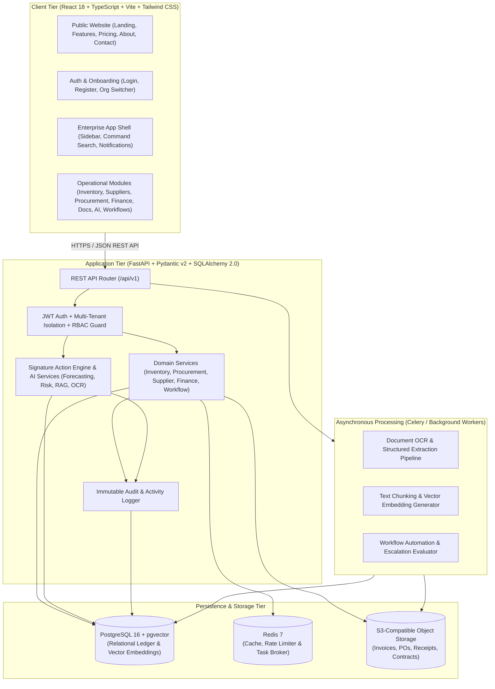
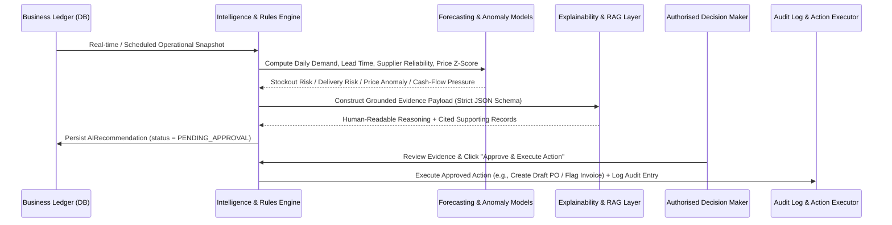

# Sutradhar — System Architecture Documentation

## 1. Executive Summary

**Sutradhar** ("One intelligent workspace to manage, understand and improve your entire business operation") is a multi-tenant, AI-powered Business Operations, Intelligence, and Decision Automation SaaS platform designed specifically for Indian MSMEs, manufacturers, and wholesale distributors.

Sutradhar connects scattered operational workflows—inventory, suppliers, procurement, purchase orders, invoices, documents, financial obligations, analytics, and human-approved automation—into a unified, explainable system of record and intelligence.

---

## 2. High-Level System Architecture

---

## 3. Multi-Tenancy & RBAC Security Model

Sutradhar enforces strict multi-tenant data isolation at both the API dependency layer and the database query layer:

1. **Tenant Context Resolution**:
   - Users authenticate via JWT access tokens (short-lived) and HTTP-only/secure refresh tokens (stored and revocable in `refresh_tokens`).
   - Every authenticated request targeting tenant resources resolves the active `organization_id` via the `X-Organization-Id` header or the user's primary membership.
   - The backend verifies that an active `Membership` exists linking `(user_id, organization_id)`.
2. **Role-Based Access Control (RBAC)**:
   - Six built-in operational roles tailored for Indian MSMEs:
     1. `OWNER` (Organisation Owner / Super Admin) — Full platform control, billing, org settings, all approvals.
     2. `OPERATIONS_MANAGER` — Inventory, warehouses, suppliers, procurement, approvals, analytics, workflows.
     3. `FINANCE_MANAGER` — Invoices, payables, receivables, cashflow, expenses, financial approvals, audit logs.
     4. `PROCUREMENT_OFFICER` — Suppliers, RFQs, quotations, purchase requests, purchase orders, document uploads.
     5. `WAREHOUSE_EMPLOYEE` — Products, stock movements, goods receipt notes (GRN), barcode lookup, low-stock alerts.
     6. `AUDITOR` — Read-only access across inventory, procurement, finance, documents, and audit logs.
   - Fine-grained permission matrix (`org:manage`, `inventory:write`, `procurement:approve`, `finance:write`, `ai:action_approve`, etc.) enforced via FastAPI dependencies (`require_permissions(...)`).

---

## 4. Signature Feature: Business Intelligence & Action Engine Pipeline

Every AI insight and recommendation in Sutradhar follows a deterministic, auditable, human-in-the-loop pipeline:

### Safety & Governance Guarantees
- **Zero Autonomous Mutations**: AI modules cannot directly alter stock balances, approve payments, issue purchase orders, or mutate financial records.
- **Ledger Integrity**: Inventory balances (`inventory_balances`) are strictly updated within ACID transactions alongside immutable `stock_movements` ledger entries.
- **Provider Abstraction**: LLM, Embedding, and OCR services use a clean adapter pattern (`app/ai/providers.py`). When external API keys (`OPENAI_API_KEY` or `GEMINI_API_KEY`) are configured, live LLM synthesis is used; alongside it, deterministic statistical engines (Scikit-learn / mathematical forecasting & rule-based extraction) always run and clearly report provider status.

