# Sutradhar — Database Architecture & ER Design

## 1. Design Principles

1. **UUID Primary Keys**: Every entity uses UUIDv4 (`UUID` / `CHAR(36)`) primary keys to prevent ID enumeration and ease distributed/multi-tenant data operations.
2. **Strict Tenant Isolation**: Every tenant-owned table includes a mandatory indexed `organization_id` foreign key referencing `organizations.id`.
3. **Immutable Inventory Ledger**: `inventory_balances` cannot be arbitrarily overwritten—every stock change must originate from a validated `stock_movements` record (`IN`, `OUT`, `ADJUSTMENT`, `TRANSFER`, `GRN_RECEIPT`) inside an ACID database transaction.
4. **Monetary Precision**: All prices, tax amounts, credit limits, and balances use `Numeric(14, 2)` (Decimal) in INR (`₹`) by default.
5. **Auditability**: All critical operations emit immutable `audit_logs` records with `actor_id`, `organization_id`, `entity_type`, `entity_id`, `action`, and `metadata_json`.
6. **Vector Search Readiness**: `document_chunks` stores text chunks with vector embeddings (`pgvector` `VECTOR(384)` / JSON embedding array with cosine similarity support) scoped by `organization_id`.

---

## 2. Entity-Relationship (ER) Diagram

```mermaid
erDiagram
    ORGANIZATIONS ||--o| ORGANIZATION_SETTINGS : "has"
    ORGANIZATIONS ||--o{ MEMBERSHIPS : "has members"
    USERS ||--o{ MEMBERSHIPS : "belongs to"
    ROLES ||--o{ MEMBERSHIPS : "assigned to"
    USERS ||--o{ REFRESH_TOKENS : "authenticates via"

    ORGANIZATIONS ||--o{ SUPPLIERS : "manages"
    SUPPLIERS ||--o{ SUPPLIER_CONTACTS : "has"
    SUPPLIERS ||--o{ SUPPLIER_DOCUMENTS : "provides"

    ORGANIZATIONS ||--o{ CATEGORIES : "defines"
    ORGANIZATIONS ||--o{ UNITS_OF_MEASURE : "defines"
    ORGANIZATIONS ||--o{ PRODUCTS : "catalogues"
    CATEGORIES ||--o{ PRODUCTS : "classifies"
    UNITS_OF_MEASURE ||--o{ PRODUCTS : "measures"

    ORGANIZATIONS ||--o{ WAREHOUSES : "operates"
    WAREHOUSES ||--o{ INVENTORY_BALANCES : "holds"
    PRODUCTS ||--o{ INVENTORY_BALANCES : "stocked as"
    WAREHOUSES ||--o{ INVENTORY_BATCHES : "tracks batches"
    PRODUCTS ||--o{ INVENTORY_BATCHES : "batched as"
    PRODUCTS ||--o{ STOCK_MOVEMENTS : "moves in"
    WAREHOUSES ||--o{ STOCK_MOVEMENTS : "recorded at"

    ORGANIZATIONS ||--o{ PURCHASE_REQUESTS : "initiates"
    PURCHASE_REQUESTS ||--o{ PURCHASE_REQUEST_ITEMS : "contains"
    ORGANIZATIONS ||--o{ RFQS : "issues"
    RFQS ||--o{ QUOTATIONS : "receives"
    SUPPLIERS ||--o{ QUOTATIONS : "submits"
    QUOTATIONS ||--o{ QUOTATION_ITEMS : "quotes"

    ORGANIZATIONS ||--o{ PURCHASE_ORDERS : "issues"
    SUPPLIERS ||--o{ PURCHASE_ORDERS : "fulfils"
    PURCHASE_ORDERS ||--o{ PURCHASE_ORDER_ITEMS : "orders"
    PURCHASE_ORDERS ||--o{ GOODS_RECEIPTS : "received via"
    GOODS_RECEIPTS ||--o{ GOODS_RECEIPT_ITEMS : "verifies"
    ORGANIZATIONS ||--o{ APPROVALS : "tracks"

    ORGANIZATIONS ||--o{ DOCUMENTS : "stores"
    DOCUMENTS ||--o{ DOCUMENT_PAGES : "contains"
    DOCUMENTS ||--o{ DOCUMENT_EXTRACTIONS : "extracted into"
    DOCUMENTS ||--o{ DOCUMENT_CHUNKS : "indexed into"

    ORGANIZATIONS ||--o{ INVOICES : "records"
    SUPPLIERS ||--o{ INVOICES : "bills"
    PURCHASE_ORDERS ||--o{ INVOICES : "matched against"
    INVOICES ||--o{ INVOICE_ITEMS : "itemises"
    INVOICES ||--o{ PAYMENTS : "settled by"
    ORGANIZATIONS ||--o{ EXPENSES : "incurs"

    ORGANIZATIONS ||--o{ AI_JOBS : "runs"
    ORGANIZATIONS ||--o{ AI_RECOMMENDATIONS : "generates"
    ORGANIZATIONS ||--o{ AI_CONVERSATIONS : "hosts"
    AI_CONVERSATIONS ||--o{ AI_MESSAGES : "logs"

    ORGANIZATIONS ||--o{ WORKFLOW_RULES : "configures"
    WORKFLOW_RULES ||--o{ WORKFLOW_RUNS : "executes"
    ORGANIZATIONS ||--o{ TASKS : "assigns"
    ORGANIZATIONS ||--o{ NOTIFICATIONS : "dispatches"
    USERS ||--o| NOTIFICATION_PREFERENCES : "customises"
    ORGANIZATIONS ||--o{ AUDIT_LOGS : "records"
    ORGANIZATIONS ||--o{ API_KEYS : "provisions"
```

---

## 3. Core Table Specifications

### 3.1 Organisation & Access Management
| Table | Key Columns | Constraints & Indexes |
|---|---|---|
| `organizations` | `id (UUID PK)`, `name`, `slug (UNIQUE)`, `gstin`, `pan`, `industry`, `currency (INR)`, `city`, `state`, `is_active`, `created_at` | `ix_organizations_slug` |
| `organization_settings` | `id (UUID PK)`, `organization_id (FK UNIQUE)`, `default_tax_rate`, `date_format (DD/MM/YYYY)`, `fiscal_year_start_month (4)`, `approval_threshold_amount`, `low_stock_alert_enabled`, `retention_days` | 1:1 with `organizations` |
| `users` | `id (UUID PK)`, `email (UNIQUE)`, `full_name`, `phone`, `hashed_password`, `is_active`, `last_login_at`, `created_at` | `ix_users_email` |
| `roles` | `id (UUID PK)`, `organization_id (FK NULLABLE)`, `code`, `name`, `description`, `is_system` | System roles + custom org roles |
| `permissions` | `id (UUID PK)`, `code (UNIQUE)`, `module`, `description` | Granular permission definitions |
| `role_permissions` | `role_id (FK)`, `permission_id (FK)` | Composite PK |
| `memberships` | `id (UUID PK)`, `user_id (FK)`, `organization_id (FK)`, `role_id (FK)`, `department`, `status (ACTIVE/INVITED/SUSPENDED)`, `is_default` | `uq_membership_user_org` |
| `refresh_tokens` | `id (UUID PK)`, `user_id (FK)`, `token_hash (UNIQUE)`, `expires_at`, `revoked_at`, `user_agent`, `ip_address` | `ix_refresh_tokens_hash` |

### 3.2 Products, Warehouses & Inventory Ledger
| Table | Key Columns | Constraints & Indexes |
|---|---|---|
| `categories` | `id`, `organization_id`, `name`, `code`, `description` | `uq_category_org_code` |
| `units_of_measure` | `id`, `organization_id`, `name`, `symbol (PCS, KG, LTR, BOX, MTR)` | `uq_uom_org_symbol` |
| `products` | `id`, `organization_id`, `category_id`, `uom_id`, `sku`, `barcode`, `hsn_code`, `name`, `description`, `unit_cost`, `selling_price`, `tax_rate (GST %)`, `reorder_point`, `safety_stock`, `lead_time_days`, `preferred_supplier_id`, `is_active` | `uq_product_org_sku`, `ix_products_org_barcode` |
| `warehouses` | `id`, `organization_id`, `name`, `code`, `city`, `state`, `address`, `manager_name`, `is_primary`, `is_active` | `uq_warehouse_org_code` |
| `inventory_balances` | `id`, `organization_id`, `product_id`, `warehouse_id`, `on_hand_qty`, `reserved_qty`, `available_qty`, `last_movement_at`, `updated_at` | `uq_inv_balance_prod_wh` |
| `inventory_batches` | `id`, `organization_id`, `product_id`, `warehouse_id`, `batch_number`, `manufacturing_date`, `expiry_date`, `quantity`, `unit_cost` | `uq_batch_org_prod_wh_num` |
| `stock_movements` | `id`, `organization_id`, `product_id`, `warehouse_id`, `batch_id`, `movement_type (IN/OUT/ADJUSTMENT/TRANSFER_IN/TRANSFER_OUT/GRN)`, `quantity`, `unit_cost`, `balance_after`, `reference_type`, `reference_id`, `notes`, `status (APPROVED/PENDING_APPROVAL)`, `created_by_id`, `approved_by_id`, `created_at` | `ix_stock_movements_org_prod_date` |

### 3.3 Suppliers, Procurement, Quotations & Receiving
| Table | Key Columns | Constraints & Indexes |
|---|---|---|
| `suppliers` | `id`, `organization_id`, `code`, `name`, `gstin`, `pan`, `email`, `phone`, `city`, `state`, `payment_terms_days`, `lead_time_days`, `on_time_delivery_rate`, `avg_delay_days`, `defect_rate`, `price_volatility_score`, `reliability_score`, `risk_category (LOW/MEDIUM/HIGH)`, `is_active` | `uq_supplier_org_code` |
| `supplier_contacts` | `id`, `organization_id`, `supplier_id`, `name`, `designation`, `email`, `phone`, `is_primary` | `ix_supplier_contacts_supplier` |
| `supplier_documents` | `id`, `organization_id`, `supplier_id`, `document_id`, `doc_type (GST_CERT/MSME_CERT/CONTRACT/PAN)` | Links supplier to `documents` |
| `purchase_requests` | `id`, `organization_id`, `pr_number`, `requested_by_id`, `warehouse_id`, `status (DRAFT/PENDING_APPROVAL/APPROVED/REJECTED/CONVERTED_TO_PO)`, `priority`, `required_by_date`, `total_estimated_amount`, `notes`, `created_at` | `uq_pr_org_number` |
| `purchase_request_items` | `id`, `purchase_request_id`, `product_id`, `quantity`, `estimated_unit_price`, `notes` | FK cascade |
| `rfqs` | `id`, `organization_id`, `rfq_number`, `title`, `purchase_request_id`, `status (OPEN/EVALUATING/AWARDED/CLOSED)`, `deadline_date`, `notes`, `created_at` | `uq_rfq_org_number` |
| `quotations` | `id`, `organization_id`, `rfq_id`, `supplier_id`, `quote_number`, `status (SUBMITTED/ACCEPTED/REJECTED)`, `total_amount`, `tax_amount`, `delivery_days`, `validity_date`, `notes`, `created_at` | `ix_quotations_org_rfq` |
| `quotation_items` | `id`, `quotation_id`, `product_id`, `quantity`, `unit_price`, `tax_rate`, `promised_lead_time_days` | FK cascade |
| `purchase_orders` | `id`, `organization_id`, `po_number`, `supplier_id`, `warehouse_id`, `purchase_request_id`, `quotation_id`, `status (DRAFT/PENDING_APPROVAL/APPROVED/ISSUED/PARTIALLY_RECEIVED/RECEIVED/CANCELLED)`, `order_date`, `expected_delivery_date`, `actual_delivery_date`, `subtotal`, `tax_amount`, `total_amount`, `notes`, `created_by_id`, `approved_by_id` | `uq_po_org_number` |
| `purchase_order_items` | `id`, `purchase_order_id`, `product_id`, `ordered_qty`, `received_qty`, `unit_price`, `tax_rate`, `line_total` | FK cascade |
| `goods_receipts` | `id`, `organization_id`, `grn_number`, `purchase_order_id`, `supplier_id`, `warehouse_id`, `received_by_id`, `received_date`, `supplier_challan_no`, `status (VERIFIED/DISCREPANCY)`, `notes` | `uq_grn_org_number` |
| `goods_receipt_items` | `id`, `goods_receipt_id`, `product_id`, `ordered_qty`, `received_qty`, `accepted_qty`, `rejected_qty`, `batch_number`, `expiry_date`, `remarks` | FK cascade |
| `approvals` | `id`, `organization_id`, `entity_type (PURCHASE_REQUEST/PURCHASE_ORDER/STOCK_ADJUSTMENT/INVOICE_PAYMENT)`, `entity_id`, `reference_number`, `amount`, `level`, `status (PENDING/APPROVED/REJECTED)`, `requested_by_id`, `approver_id`, `comments`, `decided_at`, `created_at` | `ix_approvals_org_status` |

### 3.4 Documents, Finance, AI & Automation
| Table | Key Columns | Constraints & Indexes |
|---|---|---|
| `documents` | `id`, `organization_id`, `filename`, `original_filename`, `mime_type`, `file_size_bytes`, `storage_path`, `file_hash_sha256`, `doc_type (INVOICE/PURCHASE_ORDER/RECEIPT/CONTRACT/QUOTATION/OTHER)`, `status (UPLOADED/PROCESSING/EXTRACTED/VERIFIED/DUPLICATE/FAILED)`, `supplier_id`, `uploaded_by_id`, `verified_by_id`, `verified_at`, `is_duplicate`, `duplicate_of_id` | `ix_documents_org_hash` |
| `document_pages` | `id`, `document_id`, `page_number`, `raw_text`, `ocr_confidence` | FK cascade |
| `document_extractions` | `id`, `organization_id`, `document_id`, `extracted_json`, `verified_json`, `confidence_score`, `invoice_number`, `invoice_date`, `due_date`, `supplier_name`, `supplier_gstin`, `subtotal`, `tax_amount`, `total_amount`, `po_reference`, `validation_errors`, `is_verified` | 1:N with `documents` |
| `document_chunks` | `id`, `organization_id`, `document_id`, `chunk_index`, `content`, `embedding_json`, `metadata_json` | `ix_doc_chunks_org_doc` |
| `invoices` | `id`, `organization_id`, `invoice_number`, `invoice_type (PAYABLE/RECEIVABLE)`, `supplier_id`, `customer_name`, `purchase_order_id`, `document_id`, `invoice_date`, `due_date`, `subtotal`, `tax_amount`, `total_amount`, `paid_amount`, `balance_due`, `status (DRAFT/PENDING_VERIFICATION/VERIFIED/PARTIALLY_PAID/PAID/OVERDUE/DISPUTED)`, `match_status (MATCHED/MISMATCH/UNLINKED)`, `match_notes`, `is_verified` | `ix_invoices_org_type_status` |
| `invoice_items` | `id`, `invoice_id`, `product_id`, `description`, `quantity`, `unit_price`, `tax_rate`, `line_total` | FK cascade |
| `payments` | `id`, `organization_id`, `invoice_id`, `payment_number`, `payment_date`, `amount`, `payment_method (NEFT/RTGS/UPI/CHEQUE/BANK_TRANSFER)`, `reference_utr`, `notes`, `recorded_by_id` | `ix_payments_org_invoice` |
| `expenses` | `id`, `organization_id`, `expense_number`, `category (LOGISTICS/UTILITIES/PACKAGING/MAINTENANCE/PAYROLL/OTHER)`, `vendor_name`, `expense_date`, `amount`, `tax_amount`, `payment_status`, `notes`, `created_by_id` | `ix_expenses_org_date` |
| `ai_jobs` | `id`, `organization_id`, `job_type`, `status`, `input_ref`, `result_summary`, `error_message`, `started_at`, `completed_at` | `ix_ai_jobs_org_status` |
| `ai_recommendations` | `id`, `organization_id`, `category (STOCKOUT_RISK/OVERDUE_DELIVERY/EXPENSIVE_QUOTATION/DUPLICATE_INVOICE/PO_INVOICE_MISMATCH/SUPPLIER_DETERIORATION/PAYMENT_OBLIGATION/DEAD_STOCK/UNUSUAL_ADJUSTMENT/CASHFLOW_PRESSURE)`, `severity (CRITICAL/HIGH/MEDIUM/LOW)`, `title`, `product_id`, `supplier_id`, `current_stock`, `avg_daily_demand`, `lead_time_days`, `expected_stockout_date`, `suggested_reorder_qty`, `reasoning`, `supporting_evidence_json`, `confidence_score`, `recommended_action`, `action_payload_json`, `status (OPEN/APPROVED/EXECUTED/DISMISSED)`, `feedback_rating`, `feedback_notes`, `approved_by_id`, `approved_at`, `created_at` | `ix_ai_recs_org_status_sev` |
| `ai_conversations` | `id`, `organization_id`, `user_id`, `title`, `created_at`, `updated_at` | `ix_ai_conv_org_user` |
| `ai_messages` | `id`, `conversation_id`, `role (user/assistant)`, `content`, `citations_json`, `confidence`, `feedback`, `created_at` | FK cascade |
| `workflow_rules` | `id`, `organization_id`, `name`, `description`, `trigger_event (LOW_STOCK/INVOICE_OVERDUE/PO_PENDING_APPROVAL/HIGH_RISK_SUPPLIER/DOCUMENT_EXTRACTED)`, `condition_json`, `action_type (CREATE_TASK/SEND_NOTIFICATION/ESCALATE_APPROVAL/FLAG_RECORD)`, `action_config_json`, `is_active`, `last_triggered_at`, `trigger_count` | `ix_workflow_rules_org` |
| `workflow_runs` | `id`, `organization_id`, `rule_id`, `status (SUCCESS/SKIPPED/FAILED)`, `trigger_ref`, `actions_taken_json`, `executed_at` | `ix_workflow_runs_org` |
| `tasks` | `id`, `organization_id`, `title`, `description`, `priority (LOW/MEDIUM/HIGH/URGENT)`, `status (TODO/IN_PROGRESS/COMPLETED/CANCELLED)`, `assigned_to_id`, `due_date`, `source_type`, `source_id`, `created_at` | `ix_tasks_org_status` |
| `notifications` | `id`, `organization_id`, `user_id`, `title`, `message`, `category`, `severity`, `link_url`, `is_read`, `created_at` | `ix_notifications_org_user_read` |
| `notification_preferences` | `id`, `user_id`, `organization_id`, `in_app_enabled`, `email_enabled`, `low_stock_alerts`, `approval_reminders`, `payment_due_alerts`, `ai_digest_enabled` | `uq_notif_pref_user_org` |
| `audit_logs` | `id`, `organization_id`, `actor_id`, `actor_email`, `action`, `entity_type`, `entity_id`, `summary`, `metadata_json`, `ip_address`, `created_at` | `ix_audit_logs_org_created` |
| `api_keys` | `id`, `organization_id`, `name`, `key_prefix`, `key_hash`, `scopes_json`, `is_active`, `last_used_at`, `expires_at`, `created_by_id`, `created_at` | `ix_api_keys_prefix` |

