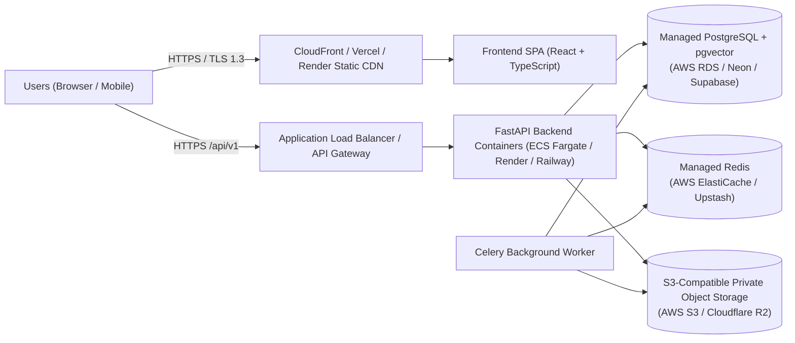

# Sutradhar — Cloud Deployment & DevOps Guide

## 1. Local Development with Docker Compose

Sutradhar includes a full `docker-compose.yml` stack orchestrating:
- `postgres`: PostgreSQL 16 with `pgvector` (`pgvector/pgvector:pg16`)
- `redis`: Redis 7 Alpine (`redis:7-alpine`) for caching and Celery broker
- `backend`: FastAPI application server with automatic Alembic migrations
- `worker`: Celery background worker for OCR, document indexing, and scheduled workflow evaluation
- `frontend`: React + TypeScript + Vite production build served via Nginx with reverse proxy to `/api`

```bash
cp .env.example .env
docker compose up --build -d
```

---

## 2. Production Cloud Architecture (AWS-Compatible & Cost-Effective Options)



### Cost Breakdown & Free-Tier vs Paid Options

| Component | Enterprise AWS Option (Paid / Free-Tier Eligible) | Student / Zero-Cost Initial Deployment Option (Free Tier) |
|---|---|---|
| **Frontend Hosting** | AWS S3 + CloudFront (Free tier: 1TB/mo data out for 12 mos) | **Vercel** or **Cloudflare Pages** (Free tier: Unlimited static bandwidth, automatic HTTPS) |
| **Backend API & Worker** | AWS ECS Fargate / App Runner (~$15–$30/mo after credits) | **Render** Web Service or **Railway** / **Fly.io** |
| **PostgreSQL + pgvector** | AWS RDS PostgreSQL `db.t4g.micro` (Free tier: 750 hrs/mo for 12 mos) | **Neon Serverless Postgres** or **Supabase** (Free tier includes `pgvector` and automated backups) |
| **Redis Cache / Broker** | AWS ElastiCache `cache.t4g.micro` | **Upstash Redis** (Free tier: 10,000 commands/day) |
| **Document Object Storage** | AWS S3 (Free tier: 5GB for 12 mos) | **Cloudflare R2** (Free tier: 10GB/month, zero egress fees, S3-compatible API) |
| **AI / LLM Provider** | OpenAI API / AWS Bedrock (Pay-per-token) | **Google Gemini API (`gemini-2.5-flash`)** (Generous free tier via Google AI Studio) or built-in deterministic local engine |

---

## 3. Required GitHub Actions Secrets for Automated Deployment

When you are ready to trigger automated deployment after pushing to GitHub, configure these secrets in **GitHub Repository → Settings → Secrets and variables → Actions**:

| Secret Name | Purpose |
|---|---|
| `PRODUCTION_DATABASE_URL` | Connection string for managed PostgreSQL (`postgresql+psycopg://...`) |
| `PRODUCTION_SECRET_KEY` | 64-byte cryptographic secret for JWT signing (`openssl rand -hex 32`) |
| `REDIS_URL` | Connection string for managed Redis (`rediss://...`) |
| `S3_ENDPOINT_URL` | S3 or Cloudflare R2 endpoint URL |
| `S3_ACCESS_KEY_ID` | S3/R2 IAM access key |
| `S3_SECRET_ACCESS_KEY` | S3/R2 IAM secret key |
| `S3_BUCKET_NAME` | Private bucket name for uploaded invoices and POs |
| `VITE_API_BASE_URL` | Public HTTPS URL of the deployed FastAPI backend |
| `DEPLOY_WEBHOOK_BACKEND` | Deployment trigger webhook (e.g., Render/Railway/AWS ECS deploy hook) |
| `DEPLOY_WEBHOOK_FRONTEND` | Frontend deployment trigger webhook (or Vercel token) |
| `GEMINI_API_KEY` / `OPENAI_API_KEY` | Optional LLM API key for generative explanations |

